# Hi, I'm Aliff

I'm a licensed tourist guide in George Town, Penang, and I build free public transport apps for Malaysia and its neighbours. I run them through [TechMavie Digital](https://techmavie.digital/?utm_source=github&utm_medium=referral&utm_campaign=profile_link), my one-person studio. I build with AI-assisted development, and I design, review, host and run everything myself.

Before this I spent seven years as a content writer for brands like Frase, Häfele and Boutir, and I've mapped buses for Moovit as a volunteer since 2019.

  <a href="https://techmavie.digital/?utm_source=github&utm_medium=referral&utm_campaign=profile_link">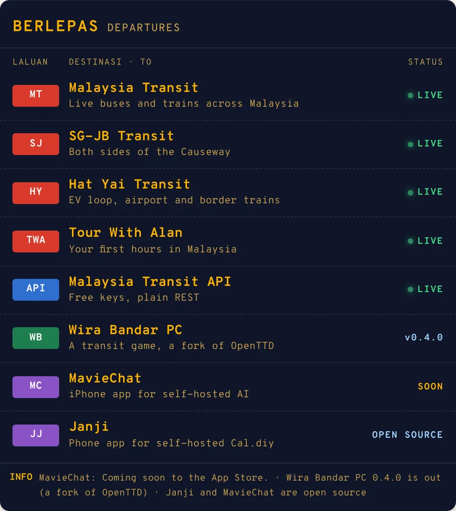</a>

## Malaysia Transit

Live buses, plus train and ferry departures, across 13 areas of Malaysia, in 13 languages. It runs on data.gov.my open data, and for operators that publish none, like KLIA Ekspres, Penang Ferry, Causeway Link and SRT, I build and maintain the timetables myself. Free on the web; the iPhone app is coming soon.

[Open Malaysia Transit](https://malaysiatransit.techmavie.digital/?utm_source=github&utm_medium=referral&utm_campaign=profile_link) · [Free API](https://techmavie.digital/transit-api?utm_source=github&utm_medium=referral&utm_campaign=profile_link) · [MCP server](https://github.com/hithereiamaliff/mcp-malaysiatransit)

  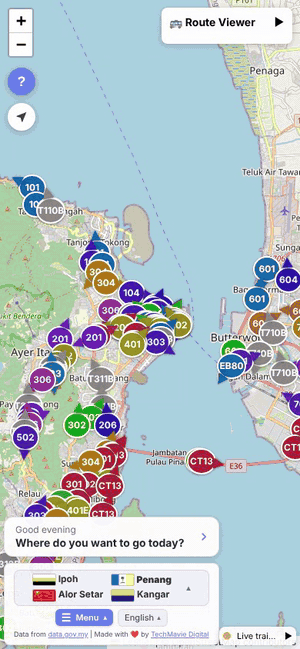
  &nbsp;
  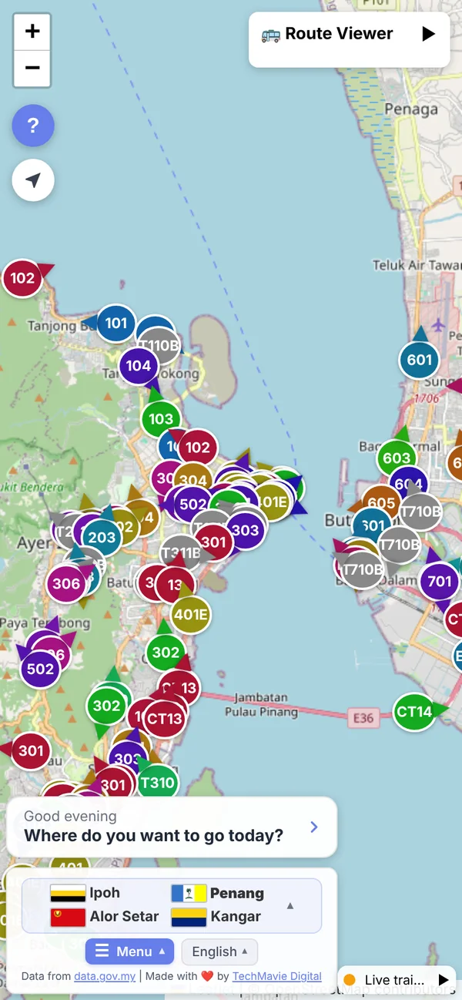

## SG-JB Transit

Singapore and Johor Bahru in one real-time view: live buses on both sides of the Causeway, journeys with fares in SGD and MYR, and how full each Singapore bus is. On the web and on the App Store.

[Open SG-JB Transit](https://sgjbtransit.techmavie.digital/?utm_source=github&utm_medium=referral&utm_campaign=profile_link) · [Download on the App Store](https://apps.apple.com/app/sg-jb-transit/id6830016567)

  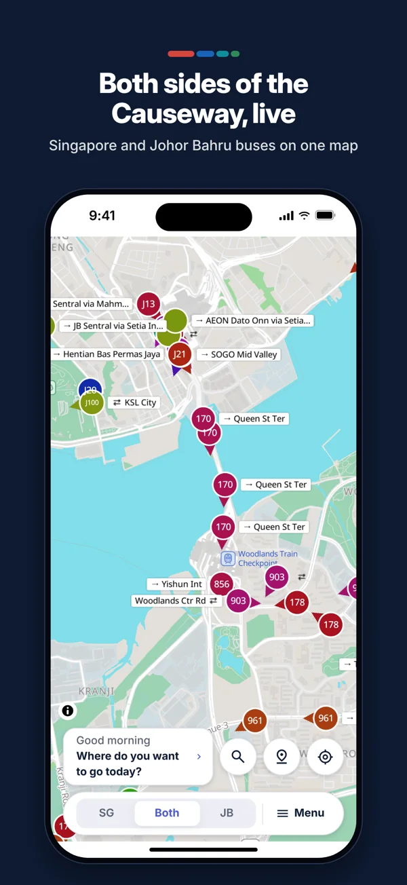
  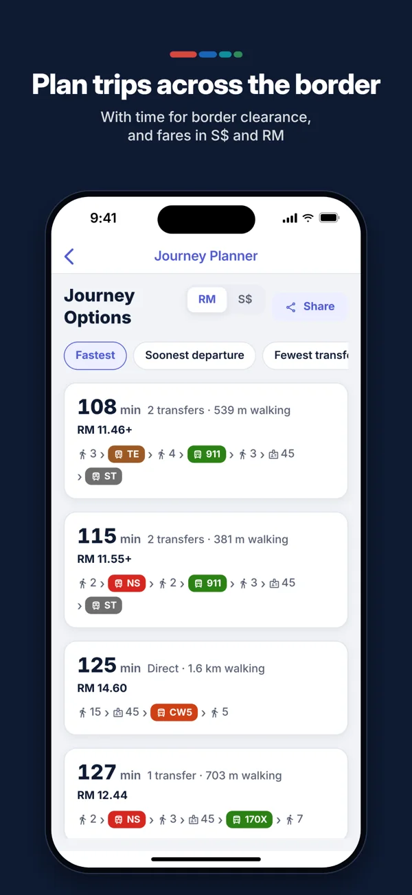
  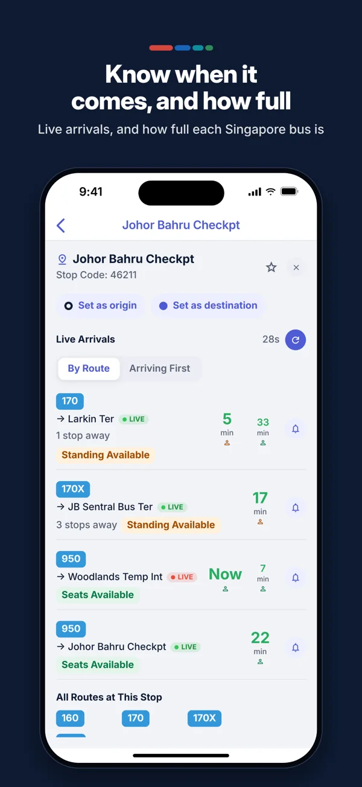
  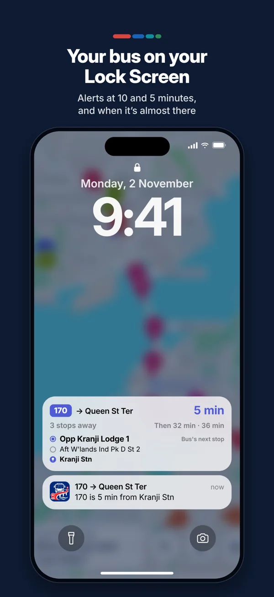

## Hat Yai Transit and Tour With Alan

| [Hat Yai Transit](https://hatyaitransit.techmavie.digital/?utm_source=github&utm_medium=referral&utm_campaign=profile_link) | [Tour With Alan](https://tourwithalan.com/?utm_source=github&utm_medium=referral&utm_campaign=profile_link) |
|:---:|:---:|
| 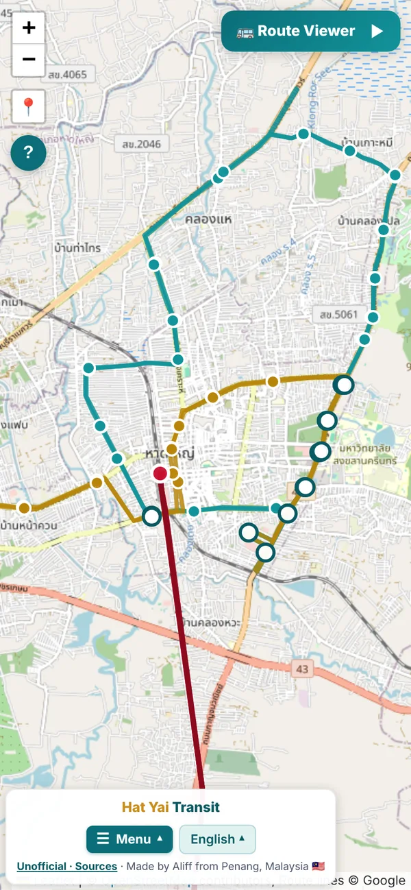 | 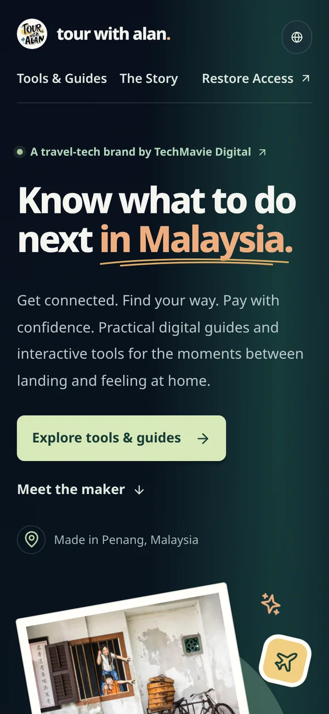 |
| The EV City Loop, the airport minibus and trains to Padang Besar on the Malaysian border, in Thai, English and Malay. Unofficial and free. | My travel brand: an arrival guide for your first hours in Malaysia, in 10 languages, from 12 airports and land borders. |

## Wira Bandar PC

A free city-building and public transport game for Windows, set in Malaysia and Singapore: bus tenders, BRT, councils and state elections. Version 0.4 adds election nights and a federal government. A fork of OpenTTD under the GNU GPL v2, not made or endorsed by the OpenTTD team.

[Download and guides](https://wirabandar.techmavie.digital/?utm_source=github&utm_medium=referral&utm_campaign=profile_link) · [Source code](https://github.com/hithereiamaliff/wirabandar)

  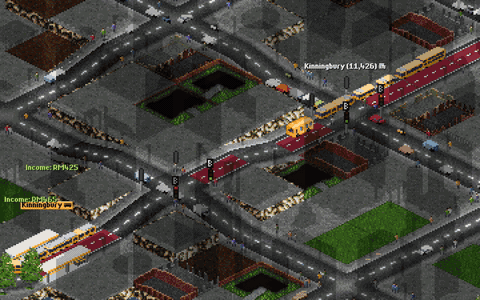
  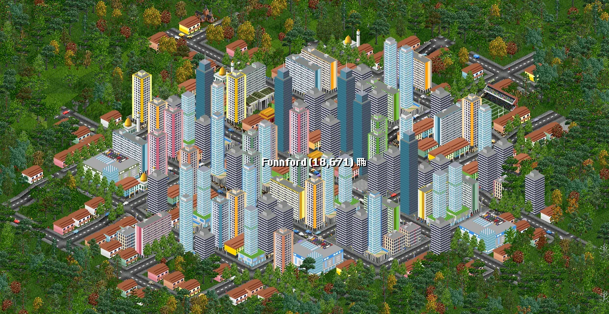

## MavieChat and Janji

Two open-source (MIT) phone apps for people who run their own servers.

| [MavieChat](https://github.com/hithereiamaliff/maviechat-app) | [Janji](https://github.com/hithereiamaliff/janji-app) |
|:---:|:---:|
| 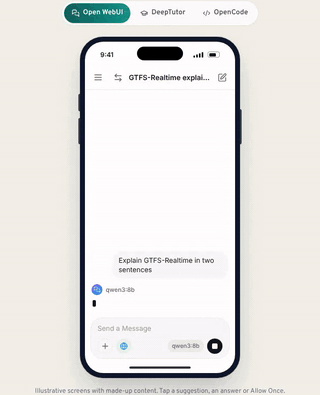 | 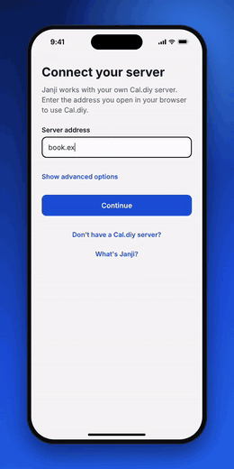 |
| A native iPhone app for Open WebUI, DeepTutor and OpenCode. Coming soon to the App Store. Not affiliated with any of them. Demo screens are illustrative. | An iOS and Android app for self-hosted Cal.diy: bookings, event types and availability. Not made by or affiliated with Cal.com, Inc. Demo data is made up. |

## Also open source

- **MCP servers** that give AI assistants live data: [Malaysia open data](https://github.com/hithereiamaliff/mcp-datagovmy), [Hat Yai Transit](https://github.com/hithereiamaliff/mcp-hatyaitransit), [GrabMaps](https://github.com/hithereiamaliff/mcp-grabmaps) and [the rest of the 18](https://techmavie.digital/modelcontextprotocol?utm_source=github&utm_medium=referral&utm_campaign=profile_link).
- **Open data**: [BAS.MY ridership](https://github.com/hithereiamaliff/basmy-opendata) and [Tourism Malaysia statistics](https://github.com/hithereiamaliff/tourismmalaysia-opendata).
- **[LHDN calculator](https://github.com/hithereiamaliff/lhdn-calculator)**: Malaysian personal income tax, worked out in the browser.

## How it's built

React, TypeScript, Vite and Tailwind on the web; Node.js and Express with GTFS and GTFS-RT pipelines behind them; Expo and React Native for the phone apps; C++ for Wira Bandar PC. Hosted on my own VPS (EasyPanel, Docker, Traefik) and Netlify.

## Elsewhere

- [mynameisaliff.co.uk](https://mynameisaliff.co.uk/?utm_source=github&utm_medium=referral&utm_campaign=profile_link): my notes, my CV, and a job-fit analyzer if you're hiring
- [Press](https://techmavie.digital/press?utm_source=github&utm_medium=referral&utm_campaign=profile_link): facts, bios and images for journalists
- [LinkedIn](https://www.linkedin.com/in/hithereiamaliff/) · [Threads](https://www.threads.com/@hiiialanhere)
- [Support my work](https://techmavie.digital/support?utm_source=github&utm_medium=referral&utm_campaign=profile_link): buy me a matcha latte

Malaysia Transit, Hat Yai Transit and Tour With Alan were captured from the live apps on 11 November 2026. The SG-JB Transit screens are from its App Store listing, and the MavieChat and Janji clips use made-up demo content.
